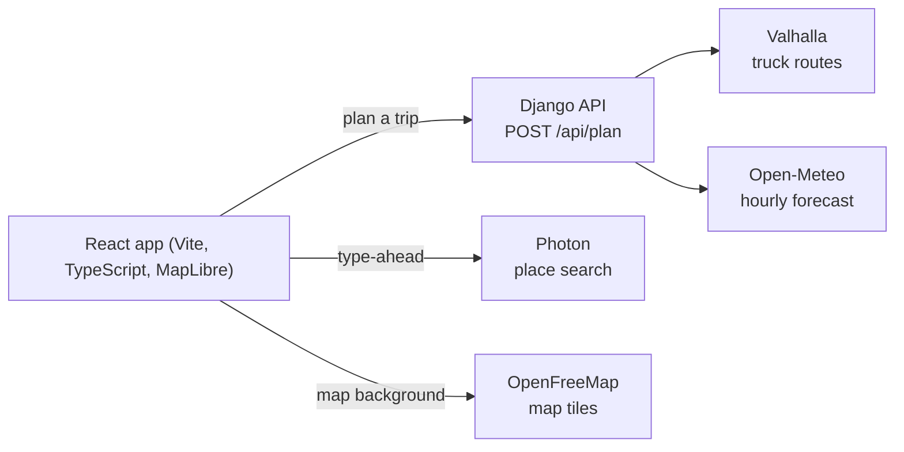

# Truck Weather Router

[](https://github.com/AnguralYash/truck-weather-router/actions/workflows/ci.yml)

A React + Django web app that helps a truck driver choose the safest route for a
trip. It finds up to three truck routes, checks the weather at the time the truck
will actually be at each point, rates the risk for the driver's load weight, and
recommends the safest route that does not cost needless time.

**Live app:** https://truck-weather-router-gamma.vercel.app
**Walkthrough video:** _added to the submission email_

## What it does

1. **Takes a trip:** origin and destination (US places, with suggestions as you
   type), departure date and time, load weight, and how often to check the weather
   (every 10, 25, or 50 miles).
2. **Finds up to 3 truck routes** from a routing service.
3. **Samples weather along each route** at the truck's estimated arrival time at
   each checkpoint, not at departure.
4. **Rates the risk** at every checkpoint as Low, Moderate, High, Severe, or No
   Travel, using the wind, rain, and snow thresholds and the load rules from the
   brief.
5. **Recommends a route** and says why, on every route's card.
6. **Shows it all on a map:** the routes, each with a label (distance and drive
   time), risk-colored checkpoint dots with arrival time and weather in a popup,
   and a **weather risk heatmap** along the corridor with a **0 to 48 hour
   forecast slider** and a play button.

## How the weather is rated

| Condition | Low | Moderate | High | Severe | No Travel |
|---|---|---|---|---|---|
| Wind (mph) | < 25 | 25-34 | 35-44 | 45-54 | 55 or more |
| Rain (in/hr) | < 0.10 | 0.10-0.25 | 0.25-0.50 | 0.50-1.00 | > 1.00 |
| Snow (in/hr) | < 0.5 | 0.5-1.0 | 1.0-2.0 | 2.0-3.0 | > 3.0 |

**Load rules** (they only ever raise a level):

- Wind of 55 mph or more is No Travel for any load.
- Wind of 45-54 mph with a load over 30,000 lb is No Travel.
- Wind of 35-44 mph with a load over 40,000 lb is Severe.

A checkpoint's risk is the **worst of its wind, rain, and snow levels**. Where the
table's ranges share an edge (rain "0.10-0.25" and "0.25-0.50"), the shared value
goes to the higher level.

## How a route is recommended

Each checkpoint covers the stretch halfway to its neighbours, which gives the miles
a route spends at each risk level. Routes are then ranked in the order the brief
gives:

1. Fewest Severe miles
2. Fewest High miles
3. Lowest average risk (weighted by miles)
4. Shortest travel time

A route containing No Travel conditions is always ranked after one without. Each
route card explains the result in one line, such as "Fewest High-risk miles: 2 mi vs
33 mi on Route 2" or, when two routes tie on risk, "only 3 s quicker, so effectively
a tie".

## Architecture



Both apps are deployed together on Vercel as two services (see
[vercel.json](vercel.json)). The API has no database and keeps no state: each plan
calls the routing and weather services and returns routes, checkpoints, risk, and
the heatmap in one response (about 50 to 100 KB).

```
apps/
  api/                  Django API
    routing/
      risk.py           thresholds, load rules, per-checkpoint risk
      summary.py        miles per risk level, average risk, route ranking
      explain.py        the one-line reason each route ranked where it did
      geometry.py       distance along a route, checkpoints, arrival times
      valhalla.py       routing client (truck profile, alternatives)
      weather.py        Open-Meteo client: batching, retry, short-lived cache
      planner.py        puts it together; builds the heatmap grid
      views.py          POST /api/plan, GET /api/health
    tests/
  web/                  React app
    src/components/     landing, form, date picker, map, route cards, heatmap slider
    src/mapData.ts      turns API data into what the map draws
    src/routeLabels.ts  route labels on the map, kept from overlapping
docs/decisions.md       every assumption and design decision, with the reason
```

## Run it locally

You need [uv](https://docs.astral.sh/uv/) (it installs Python 3.12 or newer for you)
and Node.js 22. **No API keys are needed:** every service used is keyless.

```bash
# Terminal 1: the API on http://127.0.0.1:8000
cd apps/api
uv sync
uv run python manage.py runserver

# Terminal 2: the web app on http://localhost:5173
cd apps/web
npm install
npm run dev
```

The web app's dev server forwards `/api` requests to the API, so open
http://localhost:5173 and plan a trip.

Optional environment variables for the API: `DJANGO_SECRET_KEY` (a random key is
generated at startup if unset) and `DJANGO_DEBUG=1` for debug mode.

### Tests and checks

```bash
cd apps/api && uv run pytest && uv run ruff check . && uv run ruff format --check .
cd apps/web && npm test && npm run lint && npm run build
```

The same checks run on every push and pull request in
[GitHub Actions](.github/workflows/ci.yml). The suites hold over 200 tests,
including every threshold boundary, each load rule, the ranking order and its
tiebreakers, retries, and the map's data and controls.

## API

`POST /api/plan`

```json
{
  "origin": { "lat": 42.8864, "lon": -78.8784 },
  "destination": { "lat": 43.0481, "lon": -76.1474 },
  "departure": "2026-11-05T08:00",
  "load_lb": 60000,
  "spacing_miles": 25
}
```

`departure` is the local time at the origin. The response holds the routes (ranked,
each with its geometry, checkpoints, risk summary, and ranking note), the
recommended route's id, an optional notice when fewer than three routes exist, and
the heatmap (one risk level per cell for each of the 49 hours).

Errors come back as `{ "error": { "code": "...", "message": "..." } }` with a stable
code, for example `departure_in_past`, `departure_too_far`, `invalid_load`,
`outside_service_area`, `trip_too_long`, `no_route`, and `weather_unavailable`.

## Assumptions and limits

The full list, with the reasoning, is in [docs/decisions.md](docs/decisions.md). The
ones that matter most:

- **US trips only.** The risk table is in US units, and place search is limited to
  the contiguous US.
- **Arrival times assume a steady average speed** for each route.
- **Load weight affects the weather rating, not the route.** Routes use a standard
  truck profile and are not checked against weight limits or low bridges.
- **Trips over about 1,500 km are not supported**, and some trips return fewer than
  three routes. The routing service is a free shared server with those limits, and
  the app says so on screen rather than failing quietly.
- **The weather service has a free daily quota**, so the app caps the heatmap at 80
  cells and remembers forecasts for 30 minutes.
- **Departures are limited to the next 13 days**, so a trip and its 48-hour slider
  stay inside the forecast.

Ideas that were left out on purpose (a margin for near-equal travel times,
truck-specific restrictions, local time at every checkpoint) are listed under
"Future improvements" in the decisions file.

## Credits

- Weather data by [Open-Meteo.com](https://open-meteo.com/), licensed
  [CC BY 4.0](https://creativecommons.org/licenses/by/4.0/)
- Truck routing by [Valhalla](https://valhalla.openstreetmap.de/) on OpenStreetMap
  data
- Place search by [Photon](https://photon.komoot.io/)
- Map tiles by [OpenFreeMap](https://openfreemap.org/), map data ©
  [OpenStreetMap contributors](https://www.openstreetmap.org/copyright)
